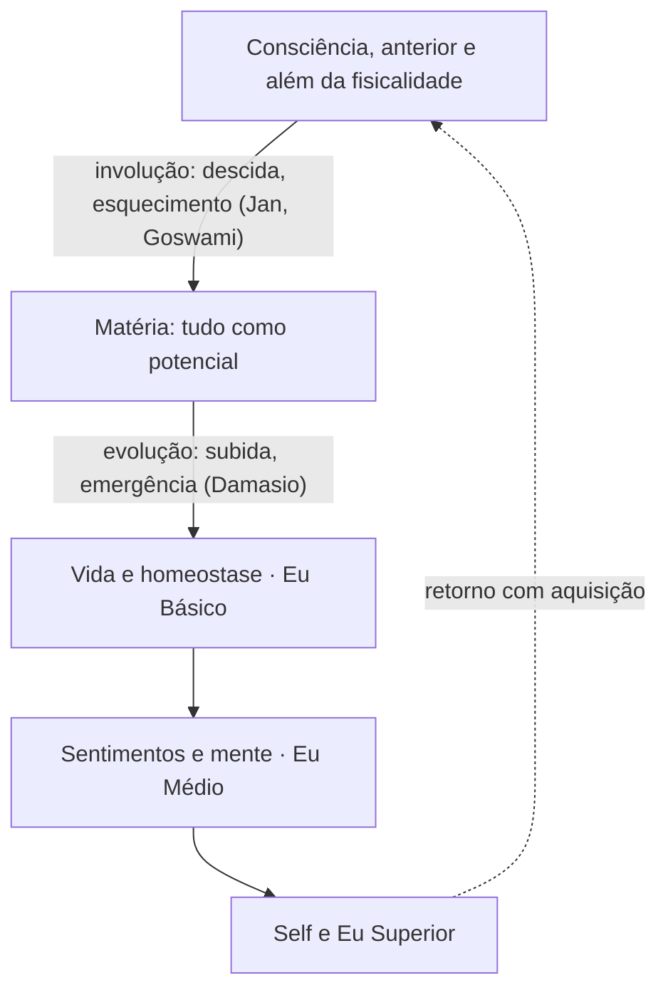

# Consciência no TSH — origem, círculo e o espaço entre sentir e agir

Registro pedido por Fabiano em 20/11/2026. Reúne a elaboração feita a partir do vídeo de Jan Val Ellam sobre os sete corpos, de Neumann, Damasio, Goswami, Cozolino e Wilber, articulada à monografia de Psicologia Transpessoal de Fabiano, ao material da ABBSP de março de 2026 e às notas já existentes no acervo. Destina-se aos módulos que tratam de espiritualidade, Self, Essência, Eu Superior e da pergunta "o que é a consciência?".

Convenção desta nota: **Fabiano** marca formulação ou decisão dele; **fonte** marca o que foi conferido no texto citado; **proposta** marca articulação sugerida pelo assistente, disponível para Fabiano aceitar, ajustar ou descartar.

O mapa dos sete corpos de Jan, com a narrativa de origem e as primeiras ampliações, está no documento [Os sete corpos segundo Jan Val Ellam — mapa e ampliações para o TSH](https://claude.ai/artifact/Gu1HacbWUeBsp2sdit8xHi).

---

## 1. O filtro dos três olhos — instrumento formal da linguagem de alicerce

**Decisão de Fabiano (20/11/2026):** a distinção de Ken Wilber entre os três olhos do conhecimento passa a ser o filtro formal da "linguagem de alicerce" do TSH. O TSH usa correlações com a ciência como linguagem de alicerce e deixa claros os limites da ciência para explicar as perspectivas espirituais; o filtro é o instrumento que torna isso operável.

**Fonte (Wilber, *Os três olhos do conhecimento*; ficha em [[Wilber - Los Tres Ojos del Conocimiento]]):**

| Olho | O que vê | Como se valida |
| --- | --- | --- |
| Da carne | o sensório e o mensurável: corpo, cérebro, comportamento, dados | observação e experimento |
| Da razão (mente) | significados, conceitos, interpretações, modelos, psicologia | coerência lógica, argumentação, interpretação compartilhada |
| Da contemplação | o espiritual, o que se revela à prática contemplativa | prática, apreensão direta e confirmação por quem percorreu a mesma prática |

Wilber acrescenta que todo conhecimento válido, em qualquer olho, passa por três fios: uma **injunção** (faça isto), uma **apreensão** (veja o que aparece) e uma **confirmação ou refutação** por quem cumpriu a mesma injunção. Isso impede que a contemplação seja tratada como mera crença e impede que a ciência exija comprovação sensorial de todo sentido espiritual. Huxley diz o mesmo na abertura de *A filosofia perene*: "o conhecimento é uma função do ser" — quando o ser de quem conhece muda, muda o que pode ser conhecido (Editorial Sul-Americana, 1999, introdução, p. 3 do PDF).

### Como aplicar o filtro

1. **Qual olho vê isto?** Situar cada afirmação: dado, interpretação ou apreensão contemplativa.
2. **Qual é o método de validação desse olho?** Não pedir a uma afirmação a prova de outro olho.
3. **A afirmação está sendo usada para provar algo de outro olho?** Se sim, é erro de categoria.
4. **Tradução legítima:** quando uma linguagem de um olho é usada para iluminar o que outro vê, declarar que é tradução, preservar o estatuto de origem e usá-la para compreensão, não como prova.

### Exemplos desta elaboração

| Afirmação | Olho | Uso no TSH |
| --- | --- | --- |
| O cérebro processa em 10–50 ms e a consciência registra em 500–600 ms (Cozolino) | carne | dado, com a ressalva de que os números são ordens de grandeza |
| O presente é montado a partir do passado, e por isso repetimos padrões (Cozolino) | razão, sobre dados da carne | interpretação clínica bem fundamentada |
| A consciência emerge da vida, de baixo para cima (Damasio) | razão | modelo fisicalista: os dados são da carne, a ontologia é interpretação |
| O observador quântico é a consciência espiritual (Goswami) | razão, traduzindo entre carne e contemplação | **tradução legítima**, desde que declarada como interpretação minoritária da física |
| "A física quântica de vanguarda sabe" (Jan) | erro de categoria | converte uma tradução em prova; no TSH, reformular como tradução |
| A tríade imortal e os corpos inferiores (Jan) | contemplação (ensino revelado) | mapa, validado por coerência, diálogo com as tradições e efeito clínico, não por dado |
| Consciência extra-cerebral, anterior e além da fisicalidade (Fabiano) | contemplação, com apoio da razão | premissa espiritual do TSH; ver seção 3 |

---

## 2. O que é a consciência? A pergunta pelos três olhos

### O que a ciência responde (olho da carne)

- **Processamento rápido e lento.** O cérebro processa informação sensorial, motora e emocional em 10 a 50 ms; a atividade leva de 500 a 600 ms para chegar à mente consciente. Nesse intervalo, o cérebro funciona como mecanismo de busca nas memórias, no corpo e nas emoções e monta o presente com base num modelo do passado, que a mente toma como realidade objetiva (fonte: Cozolino, *Por que a terapia funciona*, cap. 1, "O meio segundo vital").
- **Sentir antes de saber.** A vida começou sem palavras, mente ou consciência, mas já detectava o ambiente e respondia de modo inteligente, regulada pela homeostase; sentimentos e consciência foram construídos sobre essa base (fonte: Damasio, *Sentir e saber*, Parte I, "No princípio não era o verbo").
- **Camadas do self.** Self interoceptivo, emocional-experiencial e narrativo-reflexivo, com participação da ínsula, da rede de saliência e da rede de modo padrão (fonte: ABBSP, slides 101–102).
- **Preparação antes da decisão.** Um sinal cerebral de preparação antecede a decisão consciente de mover-se (Libet), e ainda há tempo para um veto consciente.

### O que a ciência não responde

- **Por que há experiência.** A ciência descreve correlatos: o que acontece no cérebro quando há experiência. Não explica por que esses processos são acompanhados de experiência vivida. É o chamado "problema difícil" da consciência (David Chalmers, 1995).
- **Se o cérebro produz ou transmite a consciência.** William James (*Human Immortality*, 1898) distinguiu duas hipóteses compatíveis com os mesmos dados: o cérebro **produz** a consciência, ou a **transmite e limita**, como um filtro. Aldous Huxley retomou a segunda como "válvula redutora" em *As portas da percepção* (a imagem não está em *A filosofia perene*). A correlação entre cérebro e experiência, por si só, não decide entre as duas.
- **Um físico chega ao mesmo lugar.** No epílogo de *O que é vida?*, Schrödinger parte de dois fatos — o corpo funciona como mecanismo, e ele sabe por experiência direta que comanda seus movimentos — e conclui que a consciência nunca é experimentada no plural, só no singular, e que a pluralidade é aparência (UNESP, 1997, p. 99–100). É a posição de um cientista no olho da contemplação, declarada como tal.
- **A origem.** De onde vem a consciência, o que havia antes do ego e o que permanece além do corpo não são perguntas que o olho da carne alcança.

**Proposta:** a consciência extra-cerebral que Fabiano quer trazer pode ser apresentada com essa honestidade. Os dados de Cozolino, Damasio e Libet valem em qualquer das duas hipóteses; a escolha pela hipótese da transmissão é filosófica e contemplativa, e a do TSH é declarada.

### O que os mitos e as Grandes Tradições trazem (olhos da razão e da contemplação)

- **Neumann:** a consciência nasce pela separação. No começo está a uroboros, "existência no paraíso", morada pré-mundo da psique, anterior ao ego e aos opostos (p. 29), ligada ao *wu chi* chinês, o círculo vazio (p. 30). A separação dos Pais do Mundo funda os opostos e, com eles, a consciência; a perda do estado urobórico é vivida como culpa e expulsão do paraíso (p. 97).
- **Taoismo:** do *Wu Chi* (vazio primordial, anterior à existência) nasce o *Tai Chi* (existência manifestada, origem do yin-yang) (fonte: ABBSP, slide 82).
- **Jan:** a consciência desce de um Deus-força que não age, passa pelo Paraíso e pela tríade imortal e se ancora num corpo por meio de corpos-cópia.
- **Vedanta, Upanishads, Teosofia, Huna:** três corpos, cinco envoltórios, sete princípios, três eus com seus corpos sutis de substância *aka* (Long). Contagens diferentes para uma intuição comum: o ser humano é constituído em níveis.
- **Anaximandro, citado por Neumann (p. 97):** "A origem das coisas é o ilimitado", e as coisas pagam reparação por sua injustiça. Neumann lê aí uma culpa pré-humana que rompe a unidade original, a mesma estrutura do "movimento que alguém fez lá no paraíso" no Jan.

---

## 3. Duas direções: a subida e a descida

**Fabiano:** em Damasio, a consciência emerge da vida, de baixo para cima (causação ascendente, em Goswami). Para Jan e Goswami, a consciência vem primeiro e desce. A dupla involução e evolução que Goswami toma de Sri Aurobindo e de Wilber (*A física da alma*, p. 167–168) acomoda as duas: Jan descreve a descida; Damasio, a subida. Essa síntese é movimento autoral do TSH, porque integra vários mapas com coerência. O principal é trazer uma consciência extra-cerebral, anterior e além da fisicalidade.

**Fonte (Goswami, p. 167–168):** na involução, a consciência se lança para níveis cada vez mais densos e, a cada nível, esquece o anterior; no nível material, tudo é potencial. Na evolução, vida, mente e níveis superiores emergem porque já estavam presentes como potencial. Goswami acrescenta que a matéria funciona como *hardware* sobre o qual a consciência inscreve as funções vitais e mentais.

### Condições para que a síntese seja coerente (proposta)

1. **Cada mapa no seu olho.** De Damasio, o TSH usa os dados e a descrição da subida, não a ontologia fisicalista. A descida é premissa contemplativa, não dado.
2. **A síntese é do TSH, não dos autores.** Damasio não assinaria a involução; Jan não usa a homeostase. A articulação é autoral e deve ser apresentada assim.
3. **Neumann como dobradiça.** A **centroversão** é "a tendência inata da totalidade a estabelecer a unidade das suas partes"; no estágio pré-psíquico funciona como a enteléquia na biologia, uma tendência integrativa, e depois se manifesta como centro diretivo: o ego como centro da consciência e o self como centro psíquico (p. 209). É "uma irredutível função unificadora inata à estrutura psicofísica" (p. 219). Isso dá à subida uma direção: a mesma tendência que organiza o organismo organiza a psique e aponta para o Self.
4. **A base corporal em três linguagens.** As funções que Jan coloca no duplo etérico (alimento, sobrevivência, reprodução), Damasio coloca na homeostase e Neumann descreve como self corporal e simbolismo metabólico da uroboros alimentar. Na linguagem de Max Freedom Long, é o eu inferior (*unihipili*), que guarda a memória com raciocínio elementar; no TSH, o **Eu Básico**.
5. **A "podridão organizada" (Fabiano).** O corpo é matéria sujeita à entropia, mantida organizada por trabalho constante; sem ele, volta às menores partículas. O que organiza é a consciência. A "sujeira", no Jan, é consciencial e está nos corpos inferiores. Na física e na biologia, a vida é ordem mantida contra a entropia (Schrödinger, *O que é vida?*, 1944); no TSH, essa ordem é lida como trabalho da consciência.

---

## 4. Pré-pessoal e transpessoal: o paraíso de Neumann não é a origem dos místicos

**Fabiano:** o paraíso de Neumann é pré-pessoal, anterior ao ego; a origem dos místicos é transpessoal, além do ego. Os dois se parecem, mas não são o mesmo lugar. Para o TSH, o "Retorno à Essência" não é uma regressão ao estado urobórico. O modelo do Jan, curiosamente, já evita essa confusão.

### Na monografia de Fabiano (2010)

*O normal e o patológico nas vivências espirituais: explorações psicanalíticas e transpessoais* (FACIS, orientação de Márcia Tabone; arquivo em `00 - Caixa de Entrada/Monografia Pos Transpessoal`):

- percorre o "sentimento oceânico" de Freud, que o remete à indiferenciação inicial do bebê; a simbiose de Margaret Mahler, que ela mesma aproxima do sentimento oceânico; e o espaço potencial de Winnicott;
- usa a falácia pré/trans de Wilber: os componentes "pré" e "trans" são confundidos nos dois sentidos — reduz-se o transracional a infantilismo (Freud) ou eleva-se o pré-racional à glória espiritual (Jung, na leitura de Wilber);
- conclui que, na vivência espiritual saudável, a experiência é alcançada como estágio posterior de desenvolvimento, "e não como um retorno ao 'paraíso fusional materno perdido'";
- e acrescenta uma nuance própria: a fusão vivida em algumas experiências espirituais pode dar suporte ao desenvolvimento, "não como sendo o mesmo estado, mas possuindo características potenciais similares".

### O que Neumann acrescenta

- **O mesmo símbolo no começo e no fim.** O simbolismo urobórico do começo reaparece no fim do desenvolvimento (p. 44–45), e a mandala aparece no começo como paraíso e no fim como Jerusalém Celestial (p. 45). É a raiz da confusão pré/trans: o símbolo se repete, mas o lugar não.
- **Dois retornos que falham (p. 97).** Na salvação gnóstica, o caminho é a elevação da consciência e o retorno ao espírito transcendente **com perda do lado inconsciente**. Na salvação urobórica, pela Grande Mãe, é o **abandono do princípio consciente** e a volta ao inconsciente.

### Proposta: o retorno do TSH é um terceiro caminho

| Caminho | O que se perde | Linguagem clínica | No TSH |
| --- | --- | --- | --- |
| Urobórico (regressão) | a consciência, o ego | sentimento oceânico como regressão; fusão patológica | não é o Retorno à Essência |
| Gnóstico (fuga para cima) | o corpo, o inconsciente, a história | fuga espiritual (*spiritual bypassing*, John Welwood); corpo como "sujeira" | não é o Retorno à Essência |
| **Retorno com aquisição** | nada: o percurso é integrado | individuação; espaço potencial de Winnicott | **Retorno à Essência** |

- **Do jardim à cidade (Fabiano):** o começo é um jardim, que é dado; o fim é uma cidade, que é construída. É o mesmo movimento do "Paraíso B" de Jan e resolve a tensão entre retorno e criação: o fim retoma a forma da origem, mas como obra.
- **No Jan,** o corpo búdico "adorna a alma" para que ela não perca o que aprendeu (3:55–4:12), e o eu dignificado é formado pelos próprios corpos inferiores. Não há regressão (o fim é um Paraíso B) nem fuga para cima (o novo eu se forma no corpo).
- **A nuance de Fabiano** encontra apoio em Michael Washburn (*The Ego and the Dynamic Ground*), para quem o desenvolvimento espiritual pode envolver uma "regressão a serviço da transcendência". A fusão revisitada por um ego constituído não é a fusão do bebê. Isso mantém a falácia pré/trans como critério sem tornar suspeita toda experiência fusional.
- **Para o Léxico Mestre:** a Essência "antecede e transcende a existência corporal". O "antecede" é ontológico (origem transpessoal), não desenvolvimental (estado pré-ego). Explicitar isso evita que o Retorno à Essência seja lido como regressão.

---

## 5. Círculo, centro e eixo

**Fabiano:** a imagem do círculo fala muito sobre o centro e o eixo dentro do TSH.

### O que já está no material de Fabiano

- **ABBSP, março de 2026:**
  - slide 81: a mente ordinária vive no *Tai Chi* (diferenciação, julgamento, análise); a mente desperta pode acessar o *Wu Chi* (integração, percepção direta do mistério); o Qi Gong como combustível para acessar esses estados;
  - slide 82: *Wu Chi* como estado anterior à existência, o "vazio primordial"; *Tai Chi* como existência manifestada;
  - slides 60–63: os três níveis **Base** (estabilidade, Jing, Dan Tian inferior), **Eixo** (ressonância, Qi, Dan Tian médio, Self) e **Campo** (expansão, Shen, Dan Tian superior, Tao); no slide 61, o eixo vertical representa a conexão entre consciente e inconsciente;
  - slide 70: o eixo central representa a arquitetura funcional dos Três Eus;
  - slides 97–101: o Self como centro organizador da psique, simbolizado por mandalas; Jing–Qi–Shen e os três Dan Tian lidos como camadas do self.
- **No acervo:** em [[Self, Essência, Alma, Eu Superior e Fontes Integrais]], o centro como imagem de reunião, referência e orientação, e o Self junguiano como centro e circunferência da totalidade (Jung, *Psicologia e alquimia*, §44); em [[07 - Rohden - Assimilação Centro e Vida Cotidiana]], ter centro não é imobilidade; na família de mapas, "a Essência permanece como referência; o acesso oscila; o eixo torna o retorno progressivamente mais possível".

### O que Neumann acrescenta

- O círculo vazio (*wu chi*) está no começo, como estado anterior à consciência (p. 30).
- A mandala está no começo (paraíso) e no fim (Jerusalém Celestial) (p. 45).
- O centro é uma **função**: a centroversão, que no organismo é tendência integrativa e na psique se torna ego e Self (p. 209, 219).

### Proposta: o pré/trans aplicado ao círculo

O slide 81 e Neumann usam o mesmo símbolo para lugares diferentes:

- em Neumann, o *wu chi* é o estado **anterior** ao ego (pré-pessoal);
- no slide 81 e na alquimia interna taoista, o *Wu Chi* acessado pela mente desperta é o estado **além** do ego (transpessoal).

A alquimia interna taoista resolve isso do mesmo modo que a Jerusalém Celestial: o retorno ao vazio não é volta à origem, é obra. Refina-se o Jing em Qi, o Qi em Shen, e o Shen retorna ao vazio. "O retorno é o movimento do Tao" (*Tao Te Ching*, cap. 40), mas esse retorno é cultivado.

### Síntese em três imagens (proposta)

| Imagem | Sentido no TSH | Começo | Fim |
| --- | --- | --- | --- |
| **Círculo** | a totalidade | círculo vazio, dado: *wu chi*, uroboros, jardim | mandala construída: Jerusalém Celestial, Paraíso B, Self realizado |
| **Centro** | a função de reunião (centroversão) | tendência integrativa do organismo | Self como centro diretivo |
| **Eixo** | a linha vertical que liga os níveis e por onde se dá o retorno | Base: Eu Básico, Jing, Dan Tian inferior | Campo: Eu Superior, Shen, Dan Tian superior |

O eixo é o caminho entre os dois círculos. Por isso "reconhecer afastamento e reencontrar orientação" (a formulação funcional do EIXO) não é voltar ao jardim: é seguir construindo a cidade sem perder a referência.

---

## 6. O espaço entre sentir e agir — do biológico ao transpessoal

**Fabiano:** é importante consolidar a articulação entre os vários saberes que tratam do "espaço" da consciência entre o sentir e o agir. Isso explica por que repetimos padrões mesmo sabendo deles, e como treinar nesse espaço para sair do automatismo, sejam padrões do DNA, transgeracionais ou transpessoais. O diferencial do Jan está em propor que a repetição de padrões inconscientes de várias origens pode ser reorganizada pela consciência quando há trabalho adequado para assumir esse espaço.

### Por que repetimos mesmo sabendo

- **Fonte (Cozolino, cap. 1):** a diferença de velocidade entre os dois sistemas "nos ajuda a entender por que é tão comum mantermos padrões de comportamento antigos e ineficazes, apesar de repetidos fracassos". Quando tomamos consciência de uma experiência, ela já foi processada muitas vezes, já ativou memórias e iniciou padrões; apego e transferência são exemplos.
- **No acervo:** o saber é do sistema lento (Eu Médio); a repetição é do sistema rápido (Eu Básico). Ver [[Meio Segundo Vital - Transe que Não se Escolhe e os Três Eus]].
- **No mapa transpessoal:** a repetição tem também resíduos que atravessam a vida — no Jan, a "sujeira consciencial" nos corpos inferiores; em Goswami, o condicionamento vital e mental que a mônada quântica leva de uma vida a outra (p. 53, 94).

### O espaço em cada nível

| Nível | O que acontece no espaço | Autor | Olho |
| --- | --- | --- | --- |
| Biológico | sentir e responder antes de haver mente; a homeostase regula sem saber | Damasio | carne |
| Neural | o presente é montado com o passado antes que a consciência chegue; há tempo para um veto | Cozolino; Libet; Brass e Haggard (decisão de "se" agir) | carne |
| Psicológico e clínico | apego, transferência, o transe que não se escolhe; o eu inferior aceita a sugestão, o eu médio não | Cozolino; Erickson; Long; Fabiano | razão |
| Transgeracional | padrões herdados da família e, segundo estudos de epigenética ainda em debate, marcas biológicas de experiências dos pais | clínica sistêmica; epigenética | razão e carne, com cautela |
| Contemplativo | o elo entre sensação (*vedanā*) e desejo (*taṇhā*) é o ponto clássico de libertação; *saṃskāras* e *vāsanās* como impressões que voltam | budismo; yoga ([[TSH - Fotografia da Escada - Repetição, Profundidade e Percurso]]) | contemplação |
| Transpessoal | o primeiro "colapso" é livre e criativo; os seguintes tendem a repetir a memória; só com corpo o condicionamento muda | Goswami (p. 94, 97, 121) | razão, traduzindo |
| Cosmológico | resíduos emocionais prendem os corpos inferiores; o trabalho no espaço forma o eu dignificado | Jan | contemplação |

### O que se treina no espaço (proposta, a partir do acervo)

Os níveis mudam; os movimentos do treino são os mesmos:

1. **Perceber** que o automatismo começou. Cozolino descreve a atenção plena como lembrar que temos uma mente e observá-la num "palco interior"; a capacidade de autorreflexão está correlacionada ao apego seguro e ao sucesso da terapia (cap. 1). No TSH, é perceber o transe em que se entrou.
2. **Sustentar o intervalo.** Respiração, regulação, corpo: o que dá tempo ao sistema lento sem lutar contra o rápido.
3. **Reescrever pela experiência repetida.** A memória reativada fica temporariamente modificável (reconsolidação: Nader, Schafe e LeDoux, 2000; na clínica, Bruce Ecker), e a trilha nova se fortalece pelo uso (Lei de Hebb; [[Quatro Passos da Mudança - Metapadrão e Lei de Hebb no TSH]]).
4. **Formar estrutura.** Este é o diferencial que Fabiano vê no Jan: o trabalho no espaço não só controla o impulso, forma um novo centro — o eu dignificado, no Jan; o EIXO, no TSH; o Self como centro diretivo, em Neumann.

O diferencial não está na ideia de um intervalo, que é antiga, mas na consequência: o intervalo é lugar de formação, não só de contenção.

---

## 7. Destinos sugeridos

| Tema | Onde |
| --- | --- |
| Filtro dos três olhos | fundamentação docente de todo o curso; apresentação breve quando ciência e espiritualidade se encontram |
| O que é a consciência; produção ou transmissão | módulo de Essência, Self e espiritualidade (M5) |
| Subida e descida; consciência extra-cerebral | M5, ao apresentar a dimensão espiritual |
| Pré/trans; retorno com aquisição; do jardim à cidade | M5.3 (Três Eus e a função EIXO), M5.5 e M5.7 (símbolos e individuação) |
| Círculo, centro e eixo | M1.7 (centro e oscilação, apresentação breve); M5.5 (mandala); M6 (órbita e Dan Tian) |
| O espaço entre sentir e agir | M1.1 (por que entender um padrão não impede que ele se repita); M2.4 (por que respostas familiares voltam); M5.4 (criar espaço entre impulso e escolha) |

---

## Fontes

**Enviadas por Fabiano em 20/11/2026**
- Neumann E. *História da origem da consciência*. São Paulo: Cultrix. Páginas: 29, 30, 44–45, 97, 209, 219.
- Damasio A. *Sentir e saber: as origens da consciência*. Parte I.
- Goswami A. *A física da alma*. Páginas: 53, 79, 94, 97, 121, 167–168.
- Cozolino L. *Por que a terapia funciona*. Cap. 1 ("O meio segundo vital") e seção "Pratique a atenção plena".
- Wilber K. *Os três olhos do conhecimento*. Petrópolis: Vozes.
- Jan Val Ellam, "É a primeira vez que alguém revela isso!", corte no canal Além do Véu, 19/11/2026: https://youtu.be/jFENKgzeiHg

**No acervo de Fabiano**
- Monografia *O normal e o patológico nas vivências espirituais: explorações psicanalíticas e transpessoais* (FACIS, 2010).
- `Imported/ABBSP - março 26 DEFINITIVO.md` (slides 60–63, 70, 81–82, 97–102).
- [[Meio Segundo Vital - Transe que Não se Escolhe e os Três Eus]]; [[Huna - Max Freedom Long e Serge King nos Três Eus]]; [[Self, Essência, Alma, Eu Superior e Fontes Integrais]]; [[Léxico Mestre do Traduzindo o Ser Humano]].

**Conferidas em 20/11/2026**
- Chalmers DJ. Facing up to the problem of consciousness. *Journal of Consciousness Studies*. 1995;2(3):200–219. O "problema difícil" é o problema da experiência.
- James W. *Human Immortality: Two Supposed Objections to the Doctrine*. Boston: Houghton Mifflin; 1898. Defende que a dependência entre mente e cérebro não decide se o cérebro produz a consciência ou a transmite e limita (teoria da transmissão).
- Washburn M. *The Ego and the Dynamic Ground: A Transpersonal Theory of Human Development*. Albany: SUNY Press; 1988 (2. ed. 1995). Desenvolvimento em espiral, de partida e retorno superior ao Fundamento Dinâmico; cap. 7, "Regression in the Service of Transcendence".
- Brass M, Haggard P. To do or not to do: the neural signature of self-control. *Journal of Neuroscience*. 2007;27(34):9141–9145. Região do córtex frontomedial dorsal associada à decisão intencional de não agir.
- Nader K, Schafe GE, LeDoux JE. Fear memories require protein synthesis in the amygdala for reconsolidation after retrieval. *Nature*. 2000;406:722–726. Memórias consolidadas, quando reativadas, voltam a um estado instável.

- Huxley A. *A filosofia perene*. Trad. C. A. Jordana. Buenos Aires: Editorial Sul-Americana; 1999 (original 1945). Introdução.
- Schrödinger E. *O que é vida?* Trad. Jesus de Paula Assis e Vera Yukie Kuwajima de Paula Assis. São Paulo: UNESP; 1997. p. 88 e Epílogo (p. 99–100), conforme subsídio de estudo de Sandro Luiz Bazzanella enviado por Fabiano.
- Welwood J. Principles of inner work: psychological and spiritual. *Journal of Transpersonal Psychology*. 1984;16(1):63–73; *Toward a Psychology of Awakening*. Boston: Shambhala; 2000.
- Lao Tse. *Tao Te Ching*. Trad. Wu Jyh Cherng. Cap. 40: "O retorno é o movimento do Caminho".

**A conferir na edição antes do material do aluno**
- Huxley A. *As portas da percepção*, 1954 ("válvula redutora").

**Notas que desenvolvem esta**
- [[O Caminho de Descida, Subida e Retorno com Aquisição]] — o caminho em etapas, para direcionar materiais e aulas.
- [[Kahneman e Cozolino - Dois Sistemas e o Meio Segundo no TSH]].
- [[Jan Val Ellam - Os Sete Corpos - Mapa e Ampliações para o TSH]].
- [[Luria - Néfesh, Rúach, Neshamá, Tikun, Descida e Retorno no TSH]].
