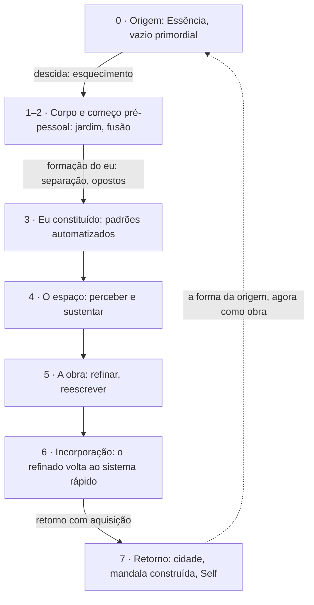

# O caminho de descida, subida e retorno com aquisição

**Direcionamento para a construção de materiais e aulas do TSH.** Registro pedido por Fabiano em 20/11/2026.

## A formulação de Fabiano

Há um caminho de compreensão que vai de cima para baixo e depois retorna refinado e sem "sujeira", depois da alquimia, da obra, da construção. É o retorno da consciência, mas com a experiência incorporada, e somente depois do refinamento. É uma proposta de caminho espiritual de crescimento e de saída dos padrões herdados, que pode se sustentar em vários saberes e tradições. Para isso, é preciso diferenciar o pré e o trans, e o que vai de cima para baixo do que vai de baixo para cima.

Este texto organiza essa formulação em etapas, com a fundamentação reunida neste chat e no acervo. As notas de origem estão no fim.

---

**O caminho é uma espiral (decisão de Fabiano, 21/11/2026).** As etapas abaixo não são degraus: voltam ao longo da vida, em outros níveis, em torno do eixo. Cada volta de um padrão é ocasião da obra. Ver [[A Espiral no TSH - Padrões que Voltam em Outro Nível]].

## 1. Duas direções que se encontram

O caminho tem dois movimentos, vistos por olhos diferentes:

| | De cima para baixo (descida) | De baixo para cima (subida) |
| --- | --- | --- |
| O que descreve | a consciência que se limita para encarnar | a vida que se organiza até a consciência de si |
| Ponto de partida | a origem: Essência, Deus-força, *Wu Chi* como vazio primordial | o corpo: homeostase, sentir antes de saber |
| Movimento | involução: a cada nível, um esquecimento | evolução: a cada nível, uma emergência |
| Vozes | Jan Val Ellam; Goswami (com Aurobindo e Wilber); tradições | Damasio; neurociência do desenvolvimento; Neumann na psicologia |
| Olho | contemplação | carne e razão |

As duas direções não competem: **a descida termina onde a subida começa — no corpo que nasce.** A descida explica de onde vem o que somos; a subida explica como nos tornamos alguém capaz de voltar.

O que as liga é o que Neumann chama de **centroversão**: a tendência inata da totalidade a unificar suas partes, que no organismo funciona como tendência integrativa e, na psique, se torna o centro do ego e o centro do Self (*História da origem da consciência*, p. 209 e 219). A mesma força que organiza o corpo aponta para o Self.

**Ponto de atenção:** a síntese é do TSH. Damasio não assina a descida, e Jan não usa a homeostase. Cada voz contribui no seu olho; a costura é autoral e deve ser apresentada assim.

---

## 2. O pré e o trans: parecem iguais, não são o mesmo lugar

No começo da vida e no fim do caminho aparecem as mesmas imagens: unidade, ausência de fronteiras, paz, o círculo. Neumann mostra que o simbolismo urobórico do começo reaparece no fim (p. 44–45), e que a mandala está no começo como paraíso e no fim como Jerusalém Celestial (p. 45). Por isso os dois lugares são confundidos — a falácia pré/trans de Ken Wilber, que Fabiano já usava na monografia de Psicologia Transpessoal (2010).

| | Pré-pessoal (o começo) | Transpessoal (o fim do caminho) |
| --- | --- | --- |
| Imagem | jardim, uroboros, fusão com a mãe | cidade, mandala construída, Paraíso B |
| Ego | ainda não existe | existe, está disponível e não é o centro |
| Diferenciação | indiferenciado | diferenciado e integrado |
| Corpo e história | não há história ainda | corpo e história incluídos |
| Capacidade simbólica | ainda não formada | plena; espaço potencial ampliado (Winnicott) |
| Efeitos na vida | dependência | presença, responsabilidade, liberdade, vínculos, contribuição |

**Na monografia de Fabiano**, a vivência espiritual saudável é alcançada como estágio posterior de desenvolvimento, "e não como um retorno ao 'paraíso fusional materno perdido'". E há uma nuance própria: a fusão vivida em algumas experiências espirituais pode dar suporte, "não como sendo o mesmo estado, mas possuindo características potenciais similares". Michael Washburn fundamenta essa nuance: para ele, o desenvolvimento é uma espiral entre o ego e sua fonte, o Fundamento Dinâmico, com uma partida na primeira metade da vida e um retorno superior na segunda, e esse retorno pode passar por uma "regressão a serviço da transcendência" (*The Ego and the Dynamic Ground*, SUNY Press, 1988; 2. ed. 1995).

**Para as aulas:** o mesmo Fundamento está presente no começo, sem diferenciação, e no fim, integrado. A diferença não é o lugar de chegada, é quem chega — alguém que passou pelo caminho.

---

## 3. As etapas do caminho

### Etapa 0 — A origem

A Essência como fundamento primordial da vida, que antecede e transcende a existência corporal (Léxico Mestre). Neste caminho, o "antecede" é **ontológico** (origem transpessoal), não **desenvolvimental** (estado anterior ao ego). Imagens: o *Wu Chi*, o vazio primordial; o Deus-força de Jan, que não age; o Uno; o Tao sem nome. Olho da contemplação. Em Luria, os níveis mais altos da alma, Chaiá e Iechidá, ficam fora da queda e da correção (comentário do *Portal das Reencarnações*, p. 8). O caminho inteiro está no *Tao Te Ching*: "Grande significa Ir / Ir significa Distante / Distante significa Retornar" (cap. 25, tradução de Wu Jyh Cherng), e o taoismo chama o caminho da imortalidade de **Via do Retorno**, a volta ao princípio (introdução da mesma tradução).

### Etapa 1 — A descida

A consciência se limita para encarnar e, a cada nível, esquece o anterior (Goswami, *A física da alma*, p. 167–168). No mapa de Jan, cada corpo nasce para resolver um limite do anterior: da tríade imortal ao quaternário de corpos-cópia que permite ao espírito se ligar a um corpo. A descida traz consigo resíduos: no Jan, a "sujeira consciencial" dos corpos inferiores; em Goswami, o condicionamento que a mônada quântica leva de uma vida a outra. Em Luria, o Infinito se contrai (*Tsimtsum*), os vasos se quebram e as centelhas ficam presas nas cascas (*Klipot*); as centelhas de Adão, maculadas, encarnam geração após geração para serem corrigidas (*Portal das Reencarnações*, p. 28). **É a primeira camada dos padrões herdados.**

### Etapa 2 — O começo pré-pessoal

O nascimento. O bebê vive o estado urobórico: fusão, ausência de opostos, o "paraíso" de Neumann (p. 29), o sentimento oceânico de Freud, a simbiose de Mahler. O corpo se organiza por homeostase antes de haver mente (Damasio). Aqui o Eu Básico se forma e grava, sem saber que grava. Luria acrescenta a ordem: a pessoa recebe primeiro a Néfesh, o nível instintivo ligado ao corpo, e só depois de corrigi-la recebe o Rúach e a Neshamá; cada nível passa por gestação, amamentação e amadurecimento (p. 9 e 11). **Segunda camada dos padrões herdados:** o que vem do corpo, da biologia, da família e do ambiente inicial.

### Etapa 3 — A formação do eu

A separação dos Pais do Mundo: surgem os opostos e, com eles, a consciência (Neumann). O ego se constitui, o Eu Médio aprende a traduzir, simbolizar e escolher. É uma etapa necessária, não uma queda a ser desfeita. Como Wilber resume, citado na monografia de Fabiano: "Se você não favorece Freud, será difícil chegar a Buda". Ao mesmo tempo, o que se repete se automatiza: o sistema rápido assume (Cozolino), o Sistema 1 não desliga e o Sistema 2 economiza esforço (Kahneman). **Terceira camada dos padrões herdados:** o que foi aprendido e se tornou automático.

### Etapa 4 — O espaço: a virada do caminho

Entre o sentir e o agir há um intervalo. O cérebro responde em 10 a 50 milissegundos; a consciência registra em 500 a 600, e nesse meio segundo o presente é montado com o passado (Cozolino, cap. 1). Há tempo para um veto (Libet; Brass e Haggard identificaram, em 2007, uma região frontomedial associada à decisão de não agir). As tradições conhecem esse lugar há muito: no budismo, o elo entre a sensação e o desejo é o ponto clássico de libertação. **É aqui que começa a saída dos padrões herdados, qualquer que seja sua origem.** Para trabalhar no espaço, não é preciso decidir de onde veio o padrão; é preciso perceber que ele começou.

O movimento da etapa: **perceber** o automatismo; **sustentar** o intervalo pela respiração, pelo corpo e pela regulação.

### Etapa 5 — A obra: o refinamento

O que se percebeu e se sustentou agora se transforma. É a alquimia, a obra, a construção.

- **A sujeira é matéria-prima, não descarte.** Na alquimia ocidental, retomada por Jung, o ouro é feito a partir da matéria escura (a *nigredo*), não apesar dela. Na alquimia interna taoista, refina-se o Jing em Qi, o Qi em Shen, e o Shen retorna ao vazio. No Jan, o eu dignificado é formado pelos próprios corpos inferiores. Na Cabala luriânica, as cascas guardam centelhas de luz, e a obra é libertá-las: **a sujeira contém luz**. Na leitura de Fabiano, o corpo é "podridão organizada", ordem mantida contra a entropia pelo trabalho da consciência; Schrödinger descreve o organismo como o que se alimenta de "entropia negativa" para escapar do decaimento (*O que é vida?*, UNESP, 1997, p. 88). **"Sem sujeira" não significa sem passado: significa passado transformado.**
- **O que a ciência mostra sobre a transformação.** Uma memória reativada fica temporariamente instável e pode ser modificada antes de se reestabilizar (reconsolidação: Nader, Schafe e LeDoux, *Nature*, 2000; na clínica, Bruce Ecker). A trilha nova se fortalece pelo uso (Lei de Hebb). Não se trata só de inibir o padrão, mas de reescrevê-lo.
- **Práticas:** respiração consciente e lenta, regulação emocional, coerência entre valores, palavras e atos (congruência, em Carl Rogers), cultivo dos três Dan Tian e da órbita, a indução de Fabiano em duas etapas (perceber e voltar).
- **A crise possível.** Washburn descreve o retorno como algo que pode atravessar o encontro com o que estava reprimido; a obra tem sua noite. O acompanhamento e os cuidados de condução das práticas valem sobretudo aqui.

### Etapa 6 — A incorporação: o refinado volta ao sistema rápido

O objetivo não é que o sistema lento passe a governar tudo, o que seria impossível e seria a fuga para cima do gnosticismo. É que o aprendido volte ao sistema rápido já transformado. Kahneman mostra que, com prática e retorno sobre os acertos, o que exigia esforço passa ao Sistema 1 e vira intuição treinada. No TSH, é a **competência incorporada**: o Eu Básico não é vencido, é reeducado. Na linguagem taoista, é a espontaneidade do *wu wei*, o agir sem esforço que vem do cultivo. No Jan, é o eu dignificado que passa a comandar o cérebro e os corpos sutis. No TSH, é o EIXO: reconhecer afastamento e reencontrar orientação, cada vez com menos esforço.

### Etapa 7 — O retorno com aquisição

A consciência volta à origem, mas com a experiência incorporada. O começo era um jardim, dado; o fim é uma cidade, construída (Neumann, p. 45). É o "Paraíso B" de Jan: algo que a origem, por ser imutável, não poderia fazer sozinha. No Jan, o corpo búdico "adorna a alma" para que ela não perca o que aprendeu. No *Tao Te Ching*, "o retorno é o movimento do Caminho" (cap. 40); "o regresso à raiz se chama quietude" (cap. 16); e o capítulo 28 diz que quem conhece o masculino e resguarda o feminino "retornará a ser criança" e "retornará à Extremidade-Inexistente", o *Wu Ji*. **O retorno à criança é condicionado ao conhecer e resguardar os opostos:** é a volta trans, não a regressão pré. Em Luria, segundo Scholem, é o ser humano quem completa o *Tikun* que não se conclui em Deus (*Las grandes tendencias de la mística judía*, p. 225); na tradição hassídica posterior, "descida para fins de subida". Em Jung e Neumann, o Self se torna centro diretivo; no TSH, o Eu Superior orienta e a Essência é reconhecida com a vida vivida. **Este é o Retorno à Essência do TSH.**

---

## 4. Os dois retornos que falham

Neumann descreve dois caminhos de "salvação" que perdem algo (p. 97). Eles ajudam a mostrar o que o caminho do TSH não é:

| Caminho | O que se perde | Como aparece na clínica e na vida espiritual |
| --- | --- | --- |
| **Regressão** (urobórico) | a consciência, o ego | busca de fusão que dissolve a pessoa; sentimento oceânico como fuga |
| **Fuga para cima** (gnóstico) | o corpo, o inconsciente, a história | *spiritual bypassing* (John Welwood); corpo e emoções tratados como sujeira a descartar |
| **Retorno com aquisição** (TSH) | nada: tudo é integrado | presença, responsabilidade, corpo incluído, história transformada |

---

## 5. A imagem do caminho: a espiral entre dois círculos

O caminho pode ser ensinado com três imagens que o TSH já usa:

- **O círculo:** a totalidade. No começo, o círculo vazio, dado (*Wu Chi*, uroboros, jardim). No fim, a mandala construída (Jerusalém Celestial, Paraíso B, Self realizado).
- **O eixo:** a linha vertical que liga os níveis — Base, Eixo e Campo; os três Dan Tian; Eu Básico, Eu Médio e Eu Superior (material da ABBSP de março de 2026, slides 60–63 e 70). É por ele que se faz a subida.
- **A espiral:** o percurso entre os dois círculos. Washburn descreve o desenvolvimento como uma espiral de partida e retorno superior; no TSH, a espiral já é o mapa do percurso construído, ao lado do pêndulo, que mostra a oscilação vivida.

---

## 6. Avaliação: onde o caminho é forte e onde pede cuidado

**Pontos fortes**

- Integra mapas de olhos diferentes sem fundi-los: cada etapa tem sua fundamentação no olho adequado.
- Resolve a tensão entre retorno e criação: retorna-se à forma da origem, mas como obra.
- Dá ao trabalho clínico com padrões um lugar dentro de um percurso espiritual, sem reduzir um ao outro.
- Dá ao corpo um lugar central do começo ao fim: é onde a descida termina, onde a subida começa e onde a obra acontece.

**Pontos que pedem cuidado**

1. **Duas linhas do tempo.** A descida é cosmológica; a subida é biográfica. Na descida, o recém-nascido está mais perto da origem; na subida, está no ponto mais pré-pessoal. Sem essa distinção, o bebê vira modelo de espiritualidade (elevacionismo) ou a espiritualidade vira infantilismo (reducionismo). Nas aulas, deixar claro em qual das duas linhas se está falando.
2. **"Sem sujeira" pode virar perfeccionismo espiritual.** Se a sujeira é entendida como algo a eliminar, o caminho vira fuga para cima. Sustentar sempre a leitura da sujeira como matéria-prima da obra.
3. **Os padrões herdados têm evidências de pesos diferentes.** O aprendido e o familiar têm forte base clínica; a transmissão biológica entre gerações (epigenética) ainda é debatida; a herança transpessoal é do olho da contemplação. O trabalho no espaço vale para todos, mas a origem atribuída a cada padrão deve ser declarada no seu olho.
4. **O caminho não é linear (decisão de Fabiano, 21/11/2026: princípio central do TSH).** Etapas se repetem em níveis diferentes ao longo da vida — por isso a espiral, e não uma escada. O padrão volta porque precisa voltar para ser transformado. Ver [[A Espiral no TSH - Padrões que Voltam em Outro Nível]].
5. **A síntese é autoral.** Apresentá-la como proposta do TSH que conversa com os autores, não como algo que os autores afirmam juntos.

---

## 7. Articulação com Jan Val Ellam

O caminho do TSH se articula com o modelo de Jan e o completa. Mapa e análise do vídeo em [[Jan Val Ellam - Os Sete Corpos - Mapa e Ampliações para o TSH]].

| Etapa do caminho | No Jan | O que o TSH acrescenta |
| --- | --- | --- |
| 0 · Origem | Deus-força que não age; o Paraíso como primeira emanação | a Essência no Léxico; o filtro dos três olhos |
| 1 · Descida | da tríade imortal ao quaternário de corpos-cópia | Goswami como tradução; as tradições como mapas paralelos |
| 2 · Pré-pessoal | concepção: os corpos sutis inferiores surgem como cópia do zigoto | Neumann, Freud, Mahler, Winnicott, Damasio: o desenvolvimento do bebê |
| 3 · Formação do eu | quase ausente | a etapa que o Jan não descreve: o ego necessário, o Eu Médio |
| 4 · O espaço | o cérebro acende antes da fala; o veto, quando a pessoa se trabalha | Cozolino, Kahneman, Libet, Brass e Haggard; o budismo |
| 5 · A obra | respiração consciente e criativa; limpeza dos vícios | alquimia, reconsolidação, práticas corporais e contemplativas do TSH |
| 6 · Incorporação | o eu dignificado comanda o cérebro e os corpos sutis | intuição treinada, competência incorporada, EIXO |
| 7 · Retorno | o Paraíso B | o Retorno à Essência; a cidade construída; o Self |

**Luria** dá ao caminho, na linguagem da Cabala, três elementos que nem Jan nem os autores científicos trazem: a **ordem** (não se recebe a Neshamá sem corrigir a Néfesh — a advertência de Welwood dita quatro séculos antes), a **luz presa na sujeira** (as centelhas nas cascas) e a **dimensão coletiva** (corrigir todo o mundo da Ação; as almas corrigidas voltam a descer para ajudar). Ver [[Luria - Néfesh, Rúach, Neshamá, Tikun, Descida e Retorno no TSH]].

**Avaliação:** o Jan evita espontaneamente a falácia pré/trans — o fim é um Paraíso B, não a volta ao Paraíso, e o eu dignificado se forma nos corpos inferiores, não fugindo deles. O que falta no modelo dele é a etapa do desenvolvimento do eu (etapa 3), que o TSH traz da psicologia, e o filtro dos três olhos, que evita usar a física como prova. A linguagem de "podridão" e "sujeira" pede tradução nas aulas, na chave de Fabiano: podridão organizada e sujeira consciencial como matéria-prima.

---

## 8. Direções para materiais e aulas

| Etapas | Onde | Foco | Imagem e prática |
| --- | --- | --- | --- |
| 4 | M1.1, M1.2 | por que entender não impede a repetição | o meio segundo; "o poder do dedo"; perceber e voltar |
| 6 | M1.3 | competência incorporada | aprender a dirigir; intuição treinada |
| 3 e 4 | M2.2 a M2.4 | o familiar parece certo; o mapa parece realidade | o que você vê é tudo que há; facilidade cognitiva |
| 4 e 5 | M4, M5.4 | criar espaço entre impulso e escolha | respiração; indução em duas etapas; reconsolidação na linguagem do aluno |
| 0, 2, 7 | M5.3, M5.5, M5.7 | Três Eus e EIXO; símbolos e individuação; pré e trans | jardim e cidade; o círculo vazio e a mandala; espiral |
| 1 e 7 | M5, dimensão espiritual | descida e retorno | o mapa dos sete corpos como um mapa entre os Mapas das Grandes Tradições |
| 5 e 6 | M6 | o eixo vertical | três Dan Tian; órbita; Base, Eixo e Campo |
| 7 | M8 | continuidade | o caminho como espiral que se repete em outros níveis |

**Para o texto do aluno,** seguir a orientação de estilo de 02/11/2026: escrita fluida, autores apresentados quando acrescentam compreensão, sem ressalvas defensivas. As distinções de olho, de evidência e de genealogia ficam nas notas do professor e nesta nota.

---

## Notas de origem

- [[Consciência no TSH - Origem, Círculo e o Espaço entre Sentir e Agir]] — o filtro dos três olhos, o que a ciência responde e não responde, subida e descida, pré e trans, círculo e eixo, o espaço entre sentir e agir.
- [[Kahneman e Cozolino - Dois Sistemas e o Meio Segundo no TSH]].
- [[Jan Val Ellam - Os Sete Corpos - Mapa e Ampliações para o TSH]].
- [[Luria - Néfesh, Rúach, Neshamá, Tikun, Descida e Retorno no TSH]].
- [[Meio Segundo Vital - Transe que Não se Escolhe e os Três Eus]]; [[Quatro Passos da Mudança - Metapadrão e Lei de Hebb no TSH]].
- Monografia de Fabiano: *O normal e o patológico nas vivências espirituais: explorações psicanalíticas e transpessoais* (FACIS, 2010).

## Fontes

- Neumann E. *História da origem da consciência*. São Paulo: Cultrix. p. 29, 30, 44–45, 97, 209, 219.
- Damasio A. *Sentir e saber: as origens da consciência*. Parte I.
- Goswami A. *A física da alma*. p. 53, 94, 97, 121, 167–168.
- Cozolino L. *Por que a terapia funciona*. Cap. 1.
- Kahneman D. *Rápido e devagar*. Rio de Janeiro: Objetiva; 2012.
- Wilber K. *Os três olhos do conhecimento*.
- Washburn M. *The Ego and the Dynamic Ground: A Transpersonal Theory of Human Development*. Albany: SUNY Press; 1988 (2. ed. 1995).
- Brass M, Haggard P. To do or not to do: the neural signature of self-control. *Journal of Neuroscience*. 2007;27(34):9141–9145.
- Nader K, Schafe GE, LeDoux JE. Fear memories require protein synthesis in the amygdala for reconsolidation after retrieval. *Nature*. 2000;406:722–726.
- Jan Val Ellam, "É a primeira vez que alguém revela isso!", corte no canal Além do Véu, 19/11/2026: https://youtu.be/jFENKgzeiHg
- Luria I. *Portal das Reencarnações* (*Sha'ar HaGuilgulim*), edição em português com comentários. p. 8, 9, 11, 28.
- Lao Tse. *Tao Te Ching: o livro do caminho e da virtude*. Tradução de Wu Jyh Cherng. Sociedade Taoísta do Brasil. Introdução; cap. 16, 25, 28 e 40.
- Schrödinger E. *O que é vida?* São Paulo: UNESP; 1997. p. 88 (entropia negativa); Epílogo, p. 99–100 (consciência singular).
- Welwood J. Principles of inner work: psychological and spiritual. *Journal of Transpersonal Psychology*. 1984;16(1):63–73 (onde cunhou *spiritual bypassing*); *Toward a Psychology of Awakening*. Boston: Shambhala; 2000.
- A conferir na edição antes do material do aluno: Jung sobre a alquimia (*Psicologia e alquimia*); Scholem, *As grandes correntes da mística judaica*.
