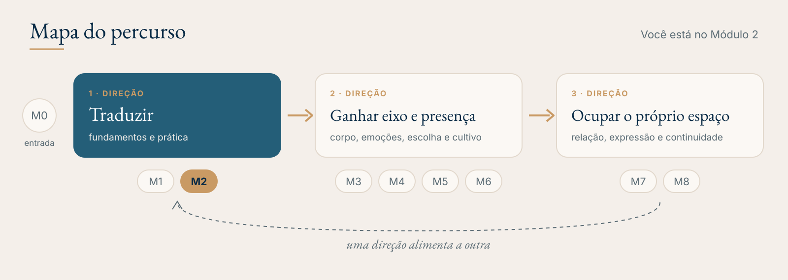

{width=6.3in}

**Liberação:** Domingo, 29/11/2026 (todo o módulo). Encontro ao vivo do módulo: 28/11.

O texto recuado é para copiar e colar como está. O resto são orientações de cadastro.

# 1. Nome do módulo

> Módulo 2 - Percepção e tradução da experiência

# 2. Descrição do módulo

> Mapa do percurso: Traduzir → Ganhar eixo e presença → Ocupar o próprio espaço\
> Você está em: **Traduzir** — a prática (o Módulo 1 trouxe os fundamentos).
>
> Neste módulo você pratica a tradução: olhar para o que acontece entre o que você vive e o que você faz. Como a percepção se forma, por que alguns sinais ganham mais importância, quando uma interpretação parece a própria realidade e por que certas respostas voltam. Ao final, você constrói e revisa uma Tradução provisória de uma situação sua.
>
> As três direções do mapa não são etapas em fila: traduzir ajuda a ganhar eixo, e o eixo ajuda a traduzir.
>
> Para onde segue: algumas camadas não estão nas ideias; estão no corpo. O Módulo 3 abre a segunda direção do percurso, ganhar eixo e presença.

A imagem do mapa acima, com o Módulo 2 destacado, está no pacote em PNG. Se a área de membros aceitar imagem de capa do módulo, ou imagem no corpo da primeira aula, ela pode ir junto.

# 3. Aulas, na ordem da plataforma

## 1. Abertura do Módulo 2

**Título**

> Abertura do Módulo 2

**Descrição da aula**

> Fabiano abre o módulo com o mapa da Semente: a Essência soterrada por camadas e o eixo como caminho de volta. Você vê onde o Módulo 2 fica no percurso e o que vem em cada aula.

- **Vídeo:** Encontro de 28/11, corte 1 (~10 min). Nome do arquivo sugerido: `TSH_M2_0a_Abertura_do_Modulo_2.mp4`
- **Liberação:** com o módulo, domingo, 29/11/2026
- **Material complementar:** —

## 2. O eixo no corpo: Zhan Zhuang

**Título**

> O eixo no corpo: Zhan Zhuang

**Descrição da aula**

> A postura da árvore, já praticada nas aulas abertas e em M1.3, agora com nome e sequência: Wu Chi, a árvore e o fechamento com a respiração no baixo ventre. É a forma corporal do eixo que acompanha o curso inteiro.

- **Vídeo:** Encontro de 28/11, corte 2 (~10 min). Nome do arquivo sugerido: `TSH_M2_0b_O_eixo_no_corpo_Zhan_Zhuang.mp4`
- **Liberação:** com o módulo, domingo, 29/11/2026
- **Material complementar:** Guia de uma página do Zhan Zhuang (PDF, no pacote)

## 3. Aula 2.1 - Como se forma o que você percebe?

**Título**

> Aula 2.1 - Como se forma o que você percebe?

**Descrição da aula**

> Perceber não é copiar o mundo. A aula mostra como atenção, estado do corpo, aprendizagem e contexto participam do que você percebe, e propõe uma exploração para comparar o que mudou: o acontecimento, a atenção ou a leitura.

- **Vídeo:** Ponte nova + teoria já gravada (~38 min). Nome do arquivo sugerido: `TSH_M2_1_Como_se_forma_o_que_voce_percebe.mp4`
- **Liberação:** com o módulo, domingo, 29/11/2026
- **Material complementar:** Apoio do aluno M2.1 (PDF existente; falta a caixa "Raiz do TSH")

## 4. Aula 2.2 - Por que alguns sinais ganham mais importância?

**Título**

> Aula 2.2 - Por que alguns sinais ganham mais importância?

**Descrição da aula**

> Por que alguns sinais ganham mais importância do que outros? Você diferencia notar, destacar, identificar o que sente e comunicar, e conhece o Eu Básico e o Eu Médio como linguagens para essa passagem.

- **Vídeo:** Ponte nova + teoria já gravada (~32 min). Nome do arquivo sugerido: `TSH_M2_2_Por_que_alguns_sinais_ganham_mais_importancia.mp4`
- **Liberação:** com o módulo, domingo, 29/11/2026
- **Material complementar:** Apoio do aluno M2.2 (PDF existente; falta a caixa "Raiz do TSH")

## 5. Aula 2.2 - Prática: O que cada pergunta destaca

**Título**

> Aula 2.2 - Prática: O que cada pergunta destaca

**Descrição da aula**

> Prática guiada para observar como a pergunta que você faz muda o que aparece na experiência.

- **Vídeo:** A gravar (~8 min). Nome do arquivo sugerido: `TSH_M2_2_Pratica_O_que_cada_pergunta_destaca.mp4`
- **Liberação:** com o módulo, domingo, 29/11/2026
- **Material complementar:** —

## 6. Aula 2.3 - Interpretações e certezas: recuperar outras pistas

**Título**

> Aula 2.3 - Interpretações e certezas: recuperar outras pistas

**Descrição da aula**

> Quando uma interpretação parece a própria realidade. Você reconhece uma leitura tomada como certa, volta a se orientar pelo ambiente e pelo corpo e formula uma pergunta capaz de rever a hipótese.

- **Vídeo:** Ponte nova + teoria já gravada (~28 min). Nome do arquivo sugerido: `TSH_M2_3_Interpretacoes_e_certezas_recuperar_outras_pistas.mp4`
- **Liberação:** com o módulo, domingo, 29/11/2026
- **Material complementar:** Apoio do aluno M2.3 (texto pronto; falta gerar o PDF com a caixa "Raiz do TSH")

## 7. Aula 2.3 - Prática: Conferir uma certeza e recuperar outras pistas

**Título**

> Aula 2.3 - Prática: Conferir uma certeza e recuperar outras pistas

**Descrição da aula**

> Prática guiada: escolher uma certeza, conferi-la no corpo e no ambiente e recuperar as pistas que tinham ficado de fora.

- **Vídeo:** A gravar (~10 min). Nome do arquivo sugerido: `TSH_M2_3_Pratica_Conferir_uma_certeza_e_recuperar_outras_pistas.mp4`
- **Liberação:** com o módulo, domingo, 29/11/2026
- **Material complementar:** —

## 8. Aula 2.4 - O que mantém a repetição de uma resposta?

**Título**

> Aula 2.4 - O que mantém a repetição de uma resposta?

**Descrição da aula**

> Por que respostas familiares voltam, mesmo quando você já as entende? A aula investiga o que mantém uma resposta (pistas, aprendizagem, proteção, consequências e vínculos) e mostra os sulcos que a repetição vai cavando.

- **Vídeo:** Teoria nova (~16 min). Nome do arquivo sugerido: `TSH_M2_4_O_que_mantem_a_repeticao_de_uma_resposta.mp4`
- **Liberação:** com o módulo, domingo, 29/11/2026
- **Material complementar:** Apoio do aluno M2.4 (a refazer pela aula reorganizada)

## 9. Aula 2.4 - Prática: Do primeiro sinal ao eixo

**Título**

> Aula 2.4 - Prática: Do primeiro sinal ao eixo

**Descrição da aula**

> Prática gravada no encontro de 28/11: perceber o primeiro sinal de uma resposta familiar e voltar ao eixo antes de seguir no automático.

- **Vídeo:** Encontro de 28/11, corte 3 (~30 min). Nome do arquivo sugerido: `TSH_M2_4_Pratica_Do_primeiro_sinal_ao_eixo.mp4`
- **Liberação:** com o módulo, domingo, 29/11/2026
- **Material complementar:** —

## 10. Aula 2.5 - Acontecimento, experiência e interpretação

**Título**

> Aula 2.5 - Acontecimento, experiência e interpretação

**Descrição da aula**

> O que aconteceu, o que foi vivido e o que foi interpretado. Você diferencia acontecimento, experiência, associação e conclusão, e vê como acolher uma leitura espiritual sem confirmá-la nem descartá-la de antemão.

- **Vídeo:** Nova (~14 min). Nome do arquivo sugerido: `TSH_M2_5_Acontecimento_experiencia_e_interpretacao.mp4`
- **Liberação:** com o módulo, domingo, 29/11/2026
- **Material complementar:** —

## 11. Aula 2.6 - Como construir e revisar uma Tradução provisória

**Título**

> Aula 2.6 - Como construir e revisar uma Tradução provisória

**Descrição da aula**

> Como construir e revisar uma Tradução provisória de uma situação sua: com dados novos, expressão e diálogo, indicando o que mudaria a leitura e escolhendo um próximo gesto. Fecha o módulo e a primeira direção do percurso.

- **Vídeo:** Nova (~14 min). Nome do arquivo sugerido: `TSH_M2_6_Como_construir_e_revisar_uma_Traducao_provisoria.mp4`
- **Liberação:** com o módulo, domingo, 29/11/2026
- **Material complementar:** —

# 4. Antes de publicar

- [ ] Nome e descrição do módulo colados.
- [ ] 11 itens cadastrados, na ordem acima, com título e descrição.
- [ ] Data de liberação programada em cada aula.
- [ ] Vídeos conferidos: som, início e fim, sem nomes nem imagens de participantes.
- [ ] Materiais complementares anexados nas aulas indicadas.
