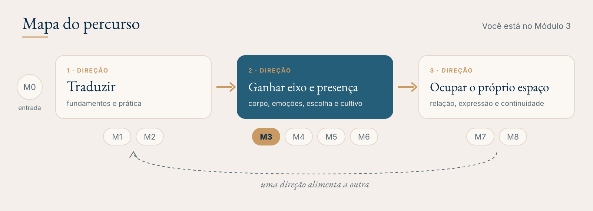

{width=6.3in}

**Liberação:** Domingo, 13/12/2026. Encontro ao vivo do módulo: 09/01/2027.

O texto recuado é para copiar e colar como está. O resto são orientações de cadastro.

# 1. Nome do módulo

> Módulo 3 - Corpo, vitalidade e práticas de cultivo

# 2. Descrição do módulo

> Mapa do percurso: Traduzir → Ganhar eixo e presença → Ocupar o próprio espaço\
> Você está em: **Ganhar eixo e presença** — 1 de 4.
>
> O corpo muda o que fica acessível. Neste módulo você aprende a perceber e a interpretar sinais internos e conhece mapas do sistema nervoso e da Medicina Chinesa. Na prática, aprende a postura da árvore (Zhan Zhuang) e o Qi Gong como formas corporais do eixo. Termina escolhendo, dosando e adaptando recursos para retornar quando perder a orientação.
>
> A auto-hipnose entra como prática do transe escolhido: entrar por escolha num estado de atenção concentrada, junto com a árvore e o Qi Gong.
>
> O módulo ganhou uma aula prática: a árvore e o Qi Gong agora têm aulas próprias.
>
> Para onde segue: com o corpo como apoio, o Módulo 4 olha para as emoções e para os padrões que um dia protegeram.
>
> Se tiver pouco tempo nesta quinzena: a aula 3.6 (a postura da árvore), a 3.8 (recursos de retorno) e o Cultivo do Eixo. Nada se perde: o resto continua aqui.

A imagem do mapa acima, com o Módulo 3 destacado, está no pacote em PNG. Se a área de membros aceitar imagem de capa do módulo, ou imagem no corpo da primeira aula, ela pode ir junto.

# 3. Aulas, na ordem da plataforma

## 1. Aula 3.1 - Estado corporal e acesso às respostas

**Título**

> Aula 3.1 - Estado corporal e acesso às respostas

**Descrição da aula**

> O corpo muda o que fica acessível. Você relaciona estado corporal, contexto e apoio ao que consegue responder, e reconhece o que muda quando está cansado ou quando está apoiado.

- **Vídeo:** A gravar. Nome do arquivo sugerido: `TSH_M3_1_Estado_corporal_e_acesso_as_respostas.mp4`
- **Liberação:** com o módulo, domingo, 13/12/2026
- **Material complementar:** Apoio do aluno de uma página (pronto, PDF)

## 2. Aula 3.2 - Interocepção: perceber e interpretar sinais internos

**Título**

> Aula 3.2 - Interocepção: perceber e interpretar sinais internos

**Descrição da aula**

> Perceber sinais internos e distinguir a sensação da interpretação que se faz dela, alternando entre o foco no corpo e as pistas do ambiente.

- **Vídeo:** A gravar. Nome do arquivo sugerido: `TSH_M3_2_Interocepcao_perceber_e_interpretar_sinais_internos.mp4`
- **Liberação:** com o módulo, domingo, 13/12/2026
- **Material complementar:** Apoio do aluno de uma página (pronto, PDF)

## 3. Aula 3.3 - Como o organismo antecipa necessidades e distribui recursos

**Título**

> Aula 3.3 - Como o organismo antecipa necessidades e distribui recursos

**Descrição da aula**

> Como o organismo antecipa necessidades e distribui recursos: demandas, descanso e capacidade disponível, e o que muda quando a exigência ou o apoio mudam.

- **Vídeo:** A gravar. Nome do arquivo sugerido: `TSH_M3_3_Como_o_organismo_antecipa_necessidades_e_distribui_recursos.mp4`
- **Liberação:** com o módulo, domingo, 13/12/2026
- **Material complementar:** Apoio do aluno de uma página (pronto, PDF)

## 4. Aula 3.4 - Sistema nervoso autônomo: mobilização, sobrecarga e repouso

**Título**

> Aula 3.4 - Sistema nervoso autônomo: mobilização, sobrecarga e repouso

**Descrição da aula**

> Mobilização útil, sobrecarga e repouso: mapas do sistema nervoso autônomo, usados com seus limites.

- **Vídeo:** A gravar. Nome do arquivo sugerido: `TSH_M3_4_Sistema_nervoso_autonomo_mobilizacao_sobrecarga_e_repouso.mp4`
- **Liberação:** com o módulo, domingo, 13/12/2026
- **Material complementar:** Apoio do aluno de uma página (pronto, PDF)

## 5. Aula 3.5 - Qi, Jing e Shen: vitalidade e cultivo na Medicina Chinesa

**Título**

> Aula 3.5 - Qi, Jing e Shen: vitalidade e cultivo na Medicina Chinesa

**Descrição da aula**

> A Medicina Chinesa como leitura do ser humano: Qi, Jing e Shen, os Cinco Shen e a experiência do Sorriso Interior, na linhagem em que Fabiano se formou.

- **Vídeo:** A gravar. Nome do arquivo sugerido: `TSH_M3_5_Qi_Jing_e_Shen_vitalidade_e_cultivo_na_Medicina_Chinesa.mp4`
- **Liberação:** com o módulo, domingo, 13/12/2026
- **Material complementar:** Apoio do aluno de uma página (pronto, PDF)

## 6. Aula 3.6 - Zhan Zhuang: aprender a postura da árvore

**Título**

> Aula 3.6 - Zhan Zhuang: aprender a postura da árvore

**Descrição da aula**

> A postura da árvore em detalhe: apoio, soltura, alinhamento, raiz e os três centros. Você encontra uma versão viável para você, em pé, sentado ou apoiado.

- **Vídeo:** A gravar. Nome do arquivo sugerido: `TSH_M3_6_Zhan_Zhuang_aprender_a_postura_da_arvore.mp4`
- **Liberação:** com o módulo, domingo, 13/12/2026
- **Material complementar:** Apoio do aluno de uma página (pronto, PDF)

## 7. Aula 3.7 - Qi Gong: postura, movimento, respiração e intenção

**Título**

> Aula 3.7 - Qi Gong: postura, movimento, respiração e intenção

**Descrição da aula**

> A árvore em movimento: Sustentar o Céu e Separar Céu e Terra, com ajustes de amplitude, ritmo e pausa.

- **Vídeo:** A gravar. Nome do arquivo sugerido: `TSH_M3_7_Qi_Gong_postura_movimento_respiracao_e_intencao.mp4`
- **Liberação:** com o módulo, domingo, 13/12/2026
- **Material complementar:** Apoio do aluno de uma página (pronto, PDF)

## 8. Aula 3.8 - Retorno à orientação: escolher e adaptar recursos

**Título**

> Aula 3.8 - Retorno à orientação: escolher e adaptar recursos

**Descrição da aula**

> Escolher, dosar e adaptar um recurso para voltar à orientação, reconhecendo quando interromper, trocar ou buscar apoio.

- **Vídeo:** A gravar. Nome do arquivo sugerido: `TSH_M3_8_Retorno_a_orientacao_escolher_e_adaptar_recursos.mp4`
- **Liberação:** com o módulo, domingo, 13/12/2026
- **Material complementar:** Apoio do aluno de uma página (pronto, PDF)

# 4. Antes de publicar

- [ ] Nome e descrição do módulo colados.
- [ ] 8 itens cadastrados, na ordem acima, com título e descrição.
- [ ] Data de liberação programada em cada aula.
- [ ] Vídeos conferidos: som, início e fim, sem nomes nem imagens de participantes.
- [ ] Materiais complementares anexados nas aulas indicadas.
- [ ] Se houver corte do encontro de 09/01/2027 (abertura ou prática), ele entra antes da primeira aula, como no Módulo 2.
