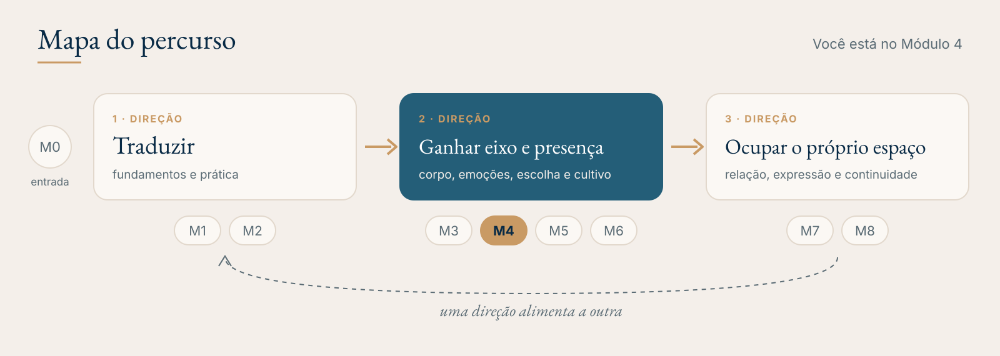

{width=6.3in}

**Liberação:** Domingo, 13/12/2026. Encontro ao vivo do módulo: 12/12.

O texto recuado é para copiar e colar como está. O resto são orientações de cadastro.

# 1. Nome do módulo

> Módulo 4 - Emoções, padrões de proteção e novas respostas

# 2. Descrição do módulo

> Mapa do percurso: Traduzir → Ganhar eixo e presença → Ocupar o próprio espaço\
> Você está em: **Ganhar eixo e presença** — 2 de 4.
>
> Dar expressão ao que você sente antes de explicar. Distinguir emoções com mais precisão e conferir se a palavra escolhida descreve o que foi vivido. Reconhecer padrões como aprendizagem e proteção, não como defeito, e escutar partes internas em conflito. O módulo termina com você ensaiando uma resposta possível numa cena concreta: pedir tempo, negociar, limitar ou buscar ajuda.
>
> Para onde segue: o Módulo 5 pergunta o que orienta as suas escolhas.

A imagem do mapa acima, com o Módulo 4 destacado, está no pacote em PNG. Se a área de membros aceitar imagem de capa do módulo, ou imagem no corpo da primeira aula, ela pode ir junto.

# 3. Aulas, na ordem da plataforma

## 1. Aula 4.1 - Reconhecer e expressar o que você sente

**Título**

> Aula 4.1 - Reconhecer e expressar o que você sente

**Descrição da aula**

> Encontrar uma primeira expressão para o que você sente (por sensação, som, imagem, palavra, gesto ou silêncio), mesmo antes de haver um nome.

- **Vídeo:** A gravar. Nome do arquivo sugerido: `TSH_M4_1_Reconhecer_e_expressar_o_que_voce_sente.mp4`
- **Liberação:** com o módulo, domingo, 13/12/2026
- **Material complementar:** Apoio do aluno (a produzir)

## 2. Aula 4.2 - Granularidade emocional: distinguir emoções e nuances

**Título**

> Aula 4.2 - Granularidade emocional: distinguir emoções e nuances

**Descrição da aula**

> Distinguir nuances como cansaço, frustração, medo e tristeza, e ver como cada uma muda a resposta possível.

- **Vídeo:** A gravar. Nome do arquivo sugerido: `TSH_M4_2_Granularidade_emocional_distinguir_emocoes_e_nuances.mp4`
- **Liberação:** com o módulo, domingo, 13/12/2026
- **Material complementar:** Apoio do aluno (a produzir)

## 3. Aula 4.3 - Nomear emoções e conferir o que a palavra descreve

**Título**

> Aula 4.3 - Nomear emoções e conferir o que a palavra descreve

**Descrição da aula**

> Experimentar nomes para o que você sente e conferir, no corpo e no contexto, se a palavra descreve o que foi vivido.

- **Vídeo:** A gravar. Nome do arquivo sugerido: `TSH_M4_3_Nomear_emocoes_e_conferir_o_que_a_palavra_descreve.mp4`
- **Liberação:** com o módulo, domingo, 13/12/2026
- **Material complementar:** Apoio do aluno (a produzir)

## 4. Aula 4.4 - Padrões de proteção: história e necessidades atuais

**Título**

> Aula 4.4 - Padrões de proteção: história e necessidades atuais

**Descrição da aula**

> Padrões como aprendizagem e proteção: a história que os formou, a função que cumpriram, o custo de hoje e a necessidade atual.

- **Vídeo:** A gravar. Nome do arquivo sugerido: `TSH_M4_4_Padroes_de_protecao_historia_e_necessidades_atuais.mp4`
- **Liberação:** com o módulo, domingo, 13/12/2026
- **Material complementar:** Apoio do aluno (a produzir)

## 5. Aula 4.5 - Diálogo com partes internas: o processo 3-2-1

**Título**

> Aula 4.5 - Diálogo com partes internas: o processo 3-2-1

**Descrição da aula**

> Escutar partes internas em conflito pelo processo 3-2-1, com compaixão e retorno.

- **Vídeo:** A gravar. Nome do arquivo sugerido: `TSH_M4_5_Dialogo_com_partes_internas_o_processo_3_2_1.mp4`
- **Liberação:** com o módulo, domingo, 13/12/2026
- **Material complementar:** Apoio do aluno (a produzir)

## 6. Aula 4.6 - Emoções e padrões: ensaiar uma nova resposta

**Título**

> Aula 4.6 - Emoções e padrões: ensaiar uma nova resposta

**Descrição da aula**

> Ensaiar, numa cena concreta, uma resposta possível (pedir tempo, negociar, limitar ou buscar ajuda) e acompanhar os efeitos.

- **Vídeo:** A gravar. Nome do arquivo sugerido: `TSH_M4_6_Emocoes_e_padroes_ensaiar_uma_nova_resposta.mp4`
- **Liberação:** com o módulo, domingo, 13/12/2026
- **Material complementar:** Apoio do aluno (a produzir)

# 4. Antes de publicar

- [ ] Nome e descrição do módulo colados.
- [ ] 6 itens cadastrados, na ordem acima, com título e descrição.
- [ ] Data de liberação programada em cada aula.
- [ ] Vídeos conferidos: som, início e fim, sem nomes nem imagens de participantes.
- [ ] Materiais complementares anexados nas aulas indicadas.
- [ ] Se houver corte do encontro de 12/12 (abertura ou prática), ele entra antes da primeira aula, como no Módulo 2.
