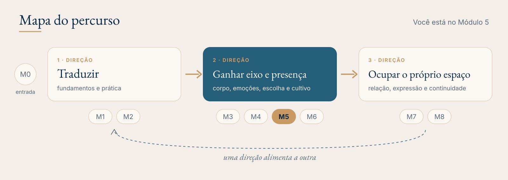

{width=6.3in}

**Liberação:** Domingo, 20/12/2026. Encontro ao vivo do módulo: 19/12.

O texto recuado é para copiar e colar como está. O resto são orientações de cadastro.

# 1. Nome do módulo

> Módulo 5 - Valores, criação e espiritualidade

# 2. Descrição do módulo

> Mapa do percurso: Traduzir → Ganhar eixo e presença → Ocupar o próprio espaço\
> Você está em: **Ganhar eixo e presença** — 3 de 4.
>
> O que fazer quando muitas vozes aparecem ao mesmo tempo? Valores como bússola, e não como ordem; os Três Eus como mapa de orientação; quietude para criar espaço entre impulso e escolha; símbolos e expressão criativa. A espiritualidade entra como dimensão legítima da experiência, com liberdade de interpretação e critérios de discernimento.
>
> O módulo ganhou uma aula prática.
>
> Para onde segue: o Módulo 6 reúne o que foi aprendido até aqui.

A imagem do mapa acima, com o Módulo 5 destacado, está no pacote em PNG. Se a área de membros aceitar imagem de capa do módulo, ou imagem no corpo da primeira aula, ela pode ir junto.

# 3. Aulas, na ordem da plataforma

## 1. Aula 5.1 - Escolhas diante de necessidades e impulsos

**Título**

> Aula 5.1 - Escolhas diante de necessidades e impulsos

**Descrição da aula**

> Quando muitas vozes aparecem ao mesmo tempo: reconhecer necessidades e impulsos diferentes e elaborar uma escolha sem entregar a decisão a uma só voz.

- **Vídeo:** A gravar. Nome do arquivo sugerido: `TSH_M5_1_Escolhas_diante_de_necessidades_e_impulsos.mp4`
- **Liberação:** com o módulo, domingo, 20/12/2026
- **Material complementar:** Apoio do aluno (a produzir)

## 2. Aula 5.2 - Valores na prática: Amor, Poder e Sabedoria

**Título**

> Aula 5.2 - Valores na prática: Amor, Poder e Sabedoria

**Descrição da aula**

> Valores como bússola: Amor, Poder e Sabedoria aplicados a uma situação concreta.

- **Vídeo:** A gravar. Nome do arquivo sugerido: `TSH_M5_2_Valores_na_pratica_Amor_Poder_e_Sabedoria.mp4`
- **Liberação:** com o módulo, domingo, 20/12/2026
- **Material complementar:** Apoio do aluno (a produzir)

## 3. Aula 5.3 - Os Três Eus: funções e orientação

**Título**

> Aula 5.3 - Os Três Eus: funções e orientação

**Descrição da aula**

> Os Três Eus (Básico, Médio e Superior) como mapa de orientação, no referencial de Max Freedom Long.

- **Vídeo:** A gravar. Nome do arquivo sugerido: `TSH_M5_3_Os_Tres_Eus_funcoes_e_orientacao.mp4`
- **Liberação:** com o módulo, domingo, 20/12/2026
- **Material complementar:** Apoio do aluno (a produzir)

## 4. Aula 5.4 - Quietude e observação da experiência

**Título**

> Aula 5.4 - Quietude e observação da experiência

**Descrição da aula**

> Quietude para criar espaço entre impulso e escolha, com apoio e silêncio.

- **Vídeo:** A gravar. Nome do arquivo sugerido: `TSH_M5_4_Quietude_e_observacao_da_experiencia.mp4`
- **Liberação:** com o módulo, domingo, 20/12/2026
- **Material complementar:** Apoio do aluno (a produzir)

## 5. Aula 5.5 - Símbolos e imagens: investigar sentidos

**Título**

> Aula 5.5 - Símbolos e imagens: investigar sentidos

**Descrição da aula**

> Explorar os sentidos possíveis de um símbolo ou de uma imagem, sabendo que uma leitura pode ser revista ou recusada.

- **Vídeo:** A gravar. Nome do arquivo sugerido: `TSH_M5_5_Simbolos_e_imagens_investigar_sentidos.mp4`
- **Liberação:** com o módulo, domingo, 20/12/2026
- **Material complementar:** Apoio do aluno (a produzir)

## 6. Aula 5.6 - Expressão criativa com desenho, escrita ou movimento

**Título**

> Aula 5.6 - Expressão criativa com desenho, escrita ou movimento

**Descrição da aula**

> Dar forma ao que pede expressão, com desenho, escrita ou movimento, e identificar uma capacidade criativa que você deseja cultivar.

- **Vídeo:** A gravar. Nome do arquivo sugerido: `TSH_M5_6_Expressao_criativa_com_desenho_escrita_ou_movimento.mp4`
- **Liberação:** com o módulo, domingo, 20/12/2026
- **Material complementar:** Apoio do aluno (a produzir)

## 7. Aula 5.7 - Espiritualidade: experiências, tradições e sentidos

**Título**

> Aula 5.7 - Espiritualidade: experiências, tradições e sentidos

**Descrição da aula**

> A espiritualidade como dimensão legítima da experiência: experiências, inclusive cotidianas, e tradições, sem exigir adesão a uma única leitura.

- **Vídeo:** A gravar. Nome do arquivo sugerido: `TSH_M5_7_Espiritualidade_experiencias_tradicoes_e_sentidos.mp4`
- **Liberação:** com o módulo, domingo, 20/12/2026
- **Material complementar:** Apoio do aluno (a produzir)

## 8. Aula 5.8 - Self, Essência, Alma, Eu Superior e Fonte: distinções

**Título**

> Aula 5.8 - Self, Essência, Alma, Eu Superior e Fonte: distinções

**Descrição da aula**

> Self, Essência, Alma, Eu Superior e Fonte: de onde vem cada termo, onde se aproximam e onde se diferenciam, e o sentido de Essência no curso.

- **Vídeo:** A gravar. Nome do arquivo sugerido: `TSH_M5_8_Self_Essencia_Alma_Eu_Superior_e_Fonte_distincoes.mp4`
- **Liberação:** com o módulo, domingo, 20/12/2026
- **Material complementar:** Apoio do aluno (a produzir)

## 9. Aula 5.9 - Discernimento espiritual: liberdade, autoridade e efeitos

**Título**

> Aula 5.9 - Discernimento espiritual: liberdade, autoridade e efeitos

**Descrição da aula**

> Discernimento espiritual: liberdade de interpretação, a relação com autoridades e os efeitos de uma experiência ao longo do tempo.

- **Vídeo:** A gravar. Nome do arquivo sugerido: `TSH_M5_9_Discernimento_espiritual_liberdade_autoridade_e_efeitos.mp4`
- **Liberação:** com o módulo, domingo, 20/12/2026
- **Material complementar:** Apoio do aluno (a produzir)

# 4. Antes de publicar

- [ ] Nome e descrição do módulo colados.
- [ ] 9 itens cadastrados, na ordem acima, com título e descrição.
- [ ] Data de liberação programada em cada aula.
- [ ] Vídeos conferidos: som, início e fim, sem nomes nem imagens de participantes.
- [ ] Materiais complementares anexados nas aulas indicadas.
- [ ] Se houver corte do encontro de 19/12 (abertura ou prática), ele entra antes da primeira aula, como no Módulo 2.
