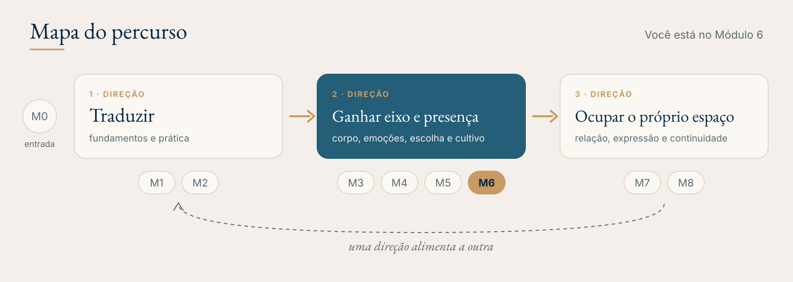

{width=6.3in}

**Liberação:** Domingo, 14/02/2027. Encontro ao vivo do módulo: 27/02/2027.

O texto recuado é para copiar e colar como está. O resto são orientações de cadastro.

# 1. Nome do módulo

> Módulo 6 - Integração da experiência e práticas de cultivo

# 2. Descrição do módulo

> Mapa do percurso: Traduzir → Ganhar eixo e presença → Ocupar o próprio espaço\
> Você está em: **Ganhar eixo e presença** — 4 de 4.
>
> Integrar não é tornar tudo igual. Neste módulo, reflexão e prática se alternam: você sustenta ambivalências, monta um mapa funcional de uma situação e aprende a pequena circulação e o Chong Mai, o canal central. Depois compara registros ao longo do tempo para ver o que mudou e o que permaneceu. Termina com um gesto possível nas condições reais da sua vida.
>
> O módulo ganhou duas aulas práticas.
>
> Para onde segue: o eixo e a presença cultivados até aqui vão para as relações. O Módulo 7 abre a terceira direção do percurso, ocupar o próprio espaço.
>
> Se tiver pouco tempo nesta quinzena: a aula 6.3 (pequena circulação), a 6.8 (escolhas nas condições reais) e o Cultivo do Eixo. Nada se perde: o resto continua aqui.

A imagem do mapa acima, com o Módulo 6 destacado, está no pacote em PNG. Se a área de membros aceitar imagem de capa do módulo, ou imagem no corpo da primeira aula, ela pode ir junto.

# 3. Aulas, na ordem da plataforma

## 1. Aula 6.1 - Integrar necessidades e preservar diferenças

**Título**

> Aula 6.1 - Integrar necessidades e preservar diferenças

**Descrição da aula**

> Integrar sem tornar tudo igual: reconhecer necessidades diferentes e o que pode coexistir.

- **Vídeo:** A gravar. Nome do arquivo sugerido: `TSH_M6_1_Integrar_necessidades_e_preservar_diferencas.mp4`
- **Liberação:** com o módulo, domingo, 14/02/2027
- **Material complementar:** Apoio do aluno (a produzir)

## 2. Aula 6.2 - Corpo, afeto, pensamento e espírito: diferenças e relações

**Título**

> Aula 6.2 - Corpo, afeto, pensamento e espírito: diferenças e relações

**Descrição da aula**

> Uma experiência vista pelas dimensões do corpo, do afeto, do pensamento e do espírito, e como elas se relacionam na pessoa inteira.

- **Vídeo:** A gravar. Nome do arquivo sugerido: `TSH_M6_2_Corpo_afeto_pensamento_e_espirito_diferencas_e_relacoes.mp4`
- **Liberação:** com o módulo, domingo, 14/02/2027
- **Material complementar:** Apoio do aluno (a produzir)

## 3. Aula 6.3 - Pequena circulação: aprender a órbita microcósmica

**Título**

> Aula 6.3 - Pequena circulação: aprender a órbita microcósmica

**Descrição da aula**

> A pequena circulação (órbita microcósmica) na versão ensinada no curso: preparação, demonstração por partes, alternativas e encerramento.

- **Vídeo:** A gravar. Nome do arquivo sugerido: `TSH_M6_3_Pequena_circulacao_aprender_a_orbita_microcosmica.mp4`
- **Liberação:** com o módulo, domingo, 14/02/2027
- **Material complementar:** Apoio do aluno (a produzir)

## 4. Aula 6.4 - Ambivalência: conflito, tempo e decisão

**Título**

> Aula 6.4 - Ambivalência: conflito, tempo e decisão

**Descrição da aula**

> Sustentar ambivalências: o que pede tempo, o que pede apoio e quais ações são possíveis sem forçar uma conciliação.

- **Vídeo:** A gravar. Nome do arquivo sugerido: `TSH_M6_4_Ambivalencia_conflito_tempo_e_decisao.mp4`
- **Liberação:** com o módulo, domingo, 14/02/2027
- **Material complementar:** Apoio do aluno (a produzir)

## 5. Aula 6.5 - Mapa de Integração Funcional: recursos, limites e ações

**Título**

> Aula 6.5 - Mapa de Integração Funcional: recursos, limites e ações

**Descrição da aula**

> O Mapa de Integração Funcional aplicado a uma situação sua: recursos, limites, relações, tempo e próximos gestos.

- **Vídeo:** A gravar. Nome do arquivo sugerido: `TSH_M6_5_Mapa_de_Integracao_Funcional_recursos_limites_e_acoes.mp4`
- **Liberação:** com o módulo, domingo, 14/02/2027
- **Material complementar:** Apoio do aluno (a produzir)

## 6. Aula 6.6 - Chong Mai e grande circulação: mapas e prática

**Título**

> Aula 6.6 - Chong Mai e grande circulação: mapas e prática

**Descrição da aula**

> Chong Mai, o canal central, e a grande circulação: o eixo no centro do corpo, na prática ensinada no curso.

- **Vídeo:** A gravar. Nome do arquivo sugerido: `TSH_M6_6_Chong_Mai_e_grande_circulacao_mapas_e_pratica.mp4`
- **Liberação:** com o módulo, domingo, 14/02/2027
- **Material complementar:** Apoio do aluno (a produzir)

## 7. Aula 6.7 - Tradução em espiral: mudanças e permanências

**Título**

> Aula 6.7 - Tradução em espiral: mudanças e permanências

**Descrição da aula**

> Comparar experiências e registros ao longo do tempo: o que mudou, o que permaneceu, o que ficou mais difícil.

- **Vídeo:** A gravar. Nome do arquivo sugerido: `TSH_M6_7_Traducao_em_espiral_mudancas_e_permanencias.mp4`
- **Liberação:** com o módulo, domingo, 14/02/2027
- **Material complementar:** Apoio do aluno (a produzir)

## 8. Aula 6.8 - Escolhas e ações nas condições reais da vida

**Título**

> Aula 6.8 - Escolhas e ações nas condições reais da vida

**Descrição da aula**

> Um gesto viável nas condições reais da sua vida: que apoio pedir, o que negociar e quando rever os efeitos. Fecha a segunda direção do percurso.

- **Vídeo:** A gravar. Nome do arquivo sugerido: `TSH_M6_8_Escolhas_e_acoes_nas_condicoes_reais_da_vida.mp4`
- **Liberação:** com o módulo, domingo, 14/02/2027
- **Material complementar:** Apoio do aluno (a produzir)

# 4. Antes de publicar

- [ ] Nome e descrição do módulo colados.
- [ ] 8 itens cadastrados, na ordem acima, com título e descrição.
- [ ] Data de liberação programada em cada aula.
- [ ] Vídeos conferidos: som, início e fim, sem nomes nem imagens de participantes.
- [ ] Materiais complementares anexados nas aulas indicadas.
- [ ] Se houver corte do encontro de 27/02/2027 (abertura ou prática), ele entra antes da primeira aula, como no Módulo 2.
