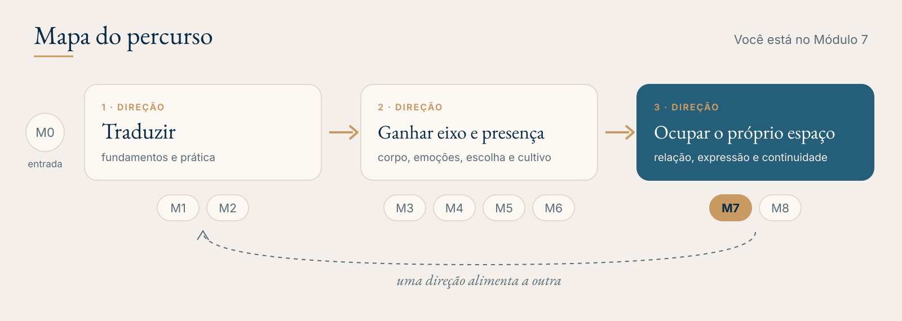

{width=6.3in}

**Liberação:** Domingo, 17/01/2027. Encontro ao vivo do módulo: 16/01.

O texto recuado é para copiar e colar como está. O resto são orientações de cadastro.

# 1. Nome do módulo

> Módulo 7 - Comunicação, vínculos, limites e reparação

# 2. Descrição do módulo

> Mapa do percurso: Traduzir → Ganhar eixo e presença → Ocupar o próprio espaço\
> Você está em: **Ocupar o próprio espaço** — 1 de 2.
>
> Ocupar o próprio espaço acontece na relação. Neste módulo você pratica expressar o que vive sem transformar a experiência em acusação, escutar sem abandonar sua posição, colocar limites sem apagar o outro, pertencer sem perder a diferença e contribuir sem se abandonar. Também examina os efeitos do que faz, com responsabilidade e sem culpa, e aprende a reparar.
>
> Para onde segue: o Módulo 8 reúne o percurso.

A imagem do mapa acima, com o Módulo 7 destacado, está no pacote em PNG. Se a área de membros aceitar imagem de capa do módulo, ou imagem no corpo da primeira aula, ela pode ir junto.

# 3. Aulas, na ordem da plataforma

## 1. Aula 7.1 - Expressão pessoal no encontro com o outro

**Título**

> Aula 7.1 - Expressão pessoal no encontro com o outro

**Descrição da aula**

> Apresentar a alguém algo vivido ou criado e ajustar a expressão no encontro, sem abandonar a própria referência.

- **Vídeo:** A gravar. Nome do arquivo sugerido: `TSH_M7_1_Expressao_pessoal_no_encontro_com_o_outro.mp4`
- **Liberação:** com o módulo, domingo, 17/01/2027
- **Material complementar:** Apoio do aluno (a produzir)

## 2. Aula 7.2 - Comunicar o vivido e formular pedidos

**Título**

> Aula 7.2 - Comunicar o vivido e formular pedidos

**Descrição da aula**

> Comunicar uma experiência e formular um pedido, separando o que aconteceu, o que foi vivido e o que foi interpretado.

- **Vídeo:** A gravar. Nome do arquivo sugerido: `TSH_M7_2_Comunicar_o_vivido_e_formular_pedidos.mp4`
- **Liberação:** com o módulo, domingo, 17/01/2027
- **Material complementar:** Apoio do aluno (a produzir)

## 3. Aula 7.3 - Escutar, perguntar e rever interpretações

**Título**

> Aula 7.3 - Escutar, perguntar e rever interpretações

**Descrição da aula**

> Escutar e resumir o que o outro viveu, perguntar, receber uma correção e rever o que você tinha entendido.

- **Vídeo:** A gravar. Nome do arquivo sugerido: `TSH_M7_3_Escutar_perguntar_e_rever_interpretacoes.mp4`
- **Liberação:** com o módulo, domingo, 17/01/2027
- **Material complementar:** Apoio do aluno (a produzir)

## 4. Aula 7.4 - Limites: pedir, negociar, recusar e encerrar

**Título**

> Aula 7.4 - Limites: pedir, negociar, recusar e encerrar

**Descrição da aula**

> Limites: o que pedir, negociar, recusar ou encerrar numa relação, ensaiado com recursos já aprendidos.

- **Vídeo:** A gravar. Nome do arquivo sugerido: `TSH_M7_4_Limites_pedir_negociar_recusar_e_encerrar.mp4`
- **Liberação:** com o módulo, domingo, 17/01/2027
- **Material complementar:** Apoio do aluno (a produzir)

## 5. Aula 7.5 - Pertencimento, diferença e conflito

**Título**

> Aula 7.5 - Pertencimento, diferença e conflito

**Descrição da aula**

> Pertencimento, diferença e conflito: participar de um grupo preservando diferenças e limites.

- **Vídeo:** A gravar. Nome do arquivo sugerido: `TSH_M7_5_Pertencimento_diferenca_e_conflito.mp4`
- **Liberação:** com o módulo, domingo, 17/01/2027
- **Material complementar:** Apoio do aluno (a produzir)

## 6. Aula 7.6 - Contribuição, serviço e cuidado de si

**Título**

> Aula 7.6 - Contribuição, serviço e cuidado de si

**Descrição da aula**

> Contribuir, servir e cuidar sem se abandonar: oferecer e receber apoio, com medida e um limite concreto.

- **Vídeo:** A gravar. Nome do arquivo sugerido: `TSH_M7_6_Contribuicao_servico_e_cuidado_de_si.mp4`
- **Liberação:** com o módulo, domingo, 17/01/2027
- **Material complementar:** Apoio do aluno (a produzir)

## 7. Aula 7.7 - Intenção, efeitos e responsabilidade

**Título**

> Aula 7.7 - Intenção, efeitos e responsabilidade

**Descrição da aula**

> Intenção, efeitos e responsabilidade: responder pelo que se faz, sem culpa e considerando as condições reais.

- **Vídeo:** A gravar. Nome do arquivo sugerido: `TSH_M7_7_Intencao_efeitos_e_responsabilidade.mp4`
- **Liberação:** com o módulo, domingo, 17/01/2027
- **Material complementar:** Apoio do aluno (a produzir)

## 8. Aula 7.8 - Reparação e aprendizagem nas relações

**Título**

> Aula 7.8 - Reparação e aprendizagem nas relações

**Descrição da aula**

> Reparar e aprender nas relações: reconhecer um efeito, formular uma reparação ou um limite e acompanhar a resposta do outro.

- **Vídeo:** A gravar. Nome do arquivo sugerido: `TSH_M7_8_Reparacao_e_aprendizagem_nas_relacoes.mp4`
- **Liberação:** com o módulo, domingo, 17/01/2027
- **Material complementar:** Apoio do aluno (a produzir)

# 4. Antes de publicar

- [ ] Nome e descrição do módulo colados.
- [ ] 8 itens cadastrados, na ordem acima, com título e descrição.
- [ ] Data de liberação programada em cada aula.
- [ ] Vídeos conferidos: som, início e fim, sem nomes nem imagens de participantes.
- [ ] Materiais complementares anexados nas aulas indicadas.
- [ ] Se houver corte do encontro de 16/01 (abertura ou prática), ele entra antes da primeira aula, como no Módulo 2.
