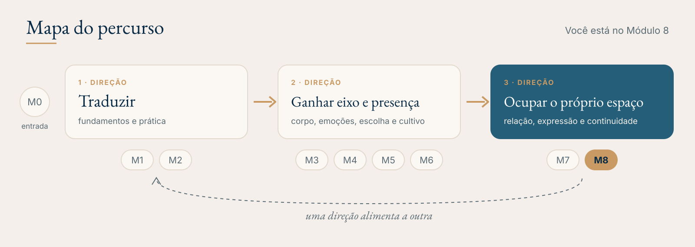

{width=6.3in}

**Liberação:** Domingo, 24/01/2027. Encontro ao vivo do módulo: 23/01.

O texto recuado é para copiar e colar como está. O resto são orientações de cadastro.

# 1. Nome do módulo

> Módulo 8 - Aprendizagens, autonomia e continuidade

# 2. Descrição do módulo

> Mapa do percurso: Traduzir → Ganhar eixo e presença → Ocupar o próprio espaço\
> Você está em: **Ocupar o próprio espaço** — 2 de 2.
>
> Você retoma a pergunta com que entrou no curso e reconhece o que aprendeu, o que já está acessível e o que ainda está em cultivo. Monta um repertório pessoal de práticas e escolhe como continuar o estudo e o cultivo, com os apoios de que precisar.
>
> O percurso não termina aqui. Traduzir, ganhar eixo e presença e ocupar o próprio espaço continuam se alimentando.

A imagem do mapa acima, com o Módulo 8 destacado, está no pacote em PNG. Se a área de membros aceitar imagem de capa do módulo, ou imagem no corpo da primeira aula, ela pode ir junto.

# 3. Aulas, na ordem da plataforma

## 1. Aula 8.1 - Revisão e aplicação das aprendizagens

**Título**

> Aula 8.1 - Revisão e aplicação das aprendizagens

**Descrição da aula**

> Retomar a pergunta com que você entrou e reconhecer o que aprendeu, o que já está acessível e o que ainda está em cultivo.

- **Vídeo:** A gravar. Nome do arquivo sugerido: `TSH_M8_1_Revisao_e_aplicacao_das_aprendizagens.mp4`
- **Liberação:** com o módulo, domingo, 24/01/2027
- **Material complementar:** Apoio do aluno (a produzir)

## 2. Aula 8.2 - Repertório pessoal e plano de prática

**Título**

> Aula 8.2 - Repertório pessoal e plano de prática

**Descrição da aula**

> Montar seu repertório pessoal de práticas e um plano de prática, com condições, apoios e revisão.

- **Vídeo:** A gravar. Nome do arquivo sugerido: `TSH_M8_2_Repertorio_pessoal_e_plano_de_pratica.mp4`
- **Liberação:** com o módulo, domingo, 24/01/2027
- **Material complementar:** Apoio do aluno (a produzir)

## 3. Aula 8.3 - Continuidade: estudo, cultivo e apoios

**Título**

> Aula 8.3 - Continuidade: estudo, cultivo e apoios

**Descrição da aula**

> Escolher como continuar o estudo e o cultivo, com uma pergunta de continuidade e os apoios de que precisar.

- **Vídeo:** A gravar. Nome do arquivo sugerido: `TSH_M8_3_Continuidade_estudo_cultivo_e_apoios.mp4`
- **Liberação:** com o módulo, domingo, 24/01/2027
- **Material complementar:** Apoio do aluno (a produzir)

# 4. Antes de publicar

- [ ] Nome e descrição do módulo colados.
- [ ] 3 itens cadastrados, na ordem acima, com título e descrição.
- [ ] Data de liberação programada em cada aula.
- [ ] Vídeos conferidos: som, início e fim, sem nomes nem imagens de participantes.
- [ ] Materiais complementares anexados nas aulas indicadas.
- [ ] Se houver corte do encontro de 23/01 (abertura ou prática), ele entra antes da primeira aula, como no Módulo 2.
